<div align="center">


<picture>
  <source media="(prefers-color-scheme: dark)" srcset="https://readme-typing-svg.demolab.com?font=Fira+Code&weight=600&size=24&duration=3500&pause=800&color=00D9FF&center=true&vCenter=true&width=600&lines=Aspiring+Front-End+Developer;42+Beirut+Cadet+%7C+CS+Student;Turning+code+into+art+%E2%9C%A8;Always+learning%2C+never+settling"/>
  
</picture>

</div>

---

##  &nbsp; whoami

```bash
$ cat ~/about.txt
```

```yaml
name:        Ali Koaik
role:        Aspiring Front-End Developer
education:   Computer Science Student @ 42 Beirut
location:    Beirut, Lebanon
currently:   Building Kami, a paper-ninja game in Unity & C#
fueled_by:   Curiosity and clean syntax
```

> I believe great software is born at the intersection of **logic** and **creativity**.
> My journey through 42's peer-to-peer pedagogy taught me that the best code is the one you understand deeply — not the one that just works.

---

##  &nbsp; Arsenal

### Languages
     

### Engines & Frameworks
   

### Environment & Tools
    

---

##  &nbsp; Things I've Built

<p align="center">
  <a href="https://github.com/Alikoaikk/Kami-UnityEngine"></a>
  <a href="https://github.com/Alikoaikk/WebServe"></a>
  <a href="https://github.com/Alikoaikk/amux-AgentWorkSpace"></a>
  <a href="https://github.com/Alikoaikk/Cub3D"></a>
</p>

---

##  &nbsp; Activity

<p align="center">
  <picture>
    <source media="(prefers-color-scheme: dark)" srcset="https://raw.githubusercontent.com/Alikoaikk/Alikoaikk/output/github-snake-dark.svg"/>
    
  </picture>
</p>

---

##  &nbsp; Let's Connect

<div align="center">

I'm always open to collaborating, learning, and exchanging ideas.
Whether it's a project, a question, or just a friendly chat — my inbox is open.

<br/>

<a href="https://linkedin.com/in/ali-koaikkoaik-86a4b4272">
  
</a>

</div>

---


